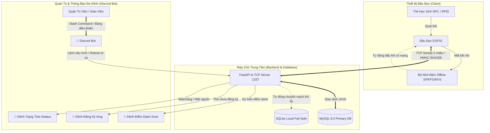

# 🏫 Hệ Thống Điểm Danh & Xác Thực Học Đường Thông Minh Bằng Thẻ NFC (ESP32-KHKT)

Dự án nghiên cứu khoa học kỹ thuật (KHKT) ứng dụng công nghệ **IoT (ESP32)**, **Giao thức mạng thời gian thực (TCP Socket)**, **Cơ chế Fail-Safe CSDL Kép** và **Discord Bot** để xây dựng giải pháp điểm danh học sinh tự động, tin cậy, chống gian lận và thông báo tức thì đến nhà trường & phụ huynh.

---

## 🏗️ Kiến Trúc Tổng Thể Hệ Thống



---

## 🌟 Các Đặc Điểm Kỹ Thuật Nổi Bật

### 1. Phía Thiết Bị Đầu Đọc ESP32 (`main/`)
- **Phần Cứng & Cảm Ứng:** Hỗ trợ mô-đun đọc thẻ NFC/RFID RC522 (giao tiếp SPI) và PN532 (giao tiếp I2C/SPI), đọc nhanh mã UID chống trùng lặp.
- **Bảo Mật Bắt Tay 3 Bước (3-Step Handshake):** Xác thực giữa ESP32 và Server bằng chữ ký số **HMAC-SHA256** kèm `nonce` và tem thời gian, chống hoàn toàn nguy cơ giả mạo thiết bị và tấn công phát lại (Replay Attack).
- **Bộ Nhớ Đệm Ngoại Tuyến (Offline Buffer):** Khi mất kết nối Wi-Fi hoặc server gián đoạn, đầu đọc tự động lưu lượt quẹt vào SPIFFS/NVS. Khi mạng phục hồi, dữ liệu được tự động gửi đồng bộ hàng loạt lên máy chủ.
- **Cấu Hình Động Không Cần Nạp Code:** Cho phép Server/Bot gửi cấu hình từ xa (giãn cách quẹt thẻ `cooldown_ms`, độ dài còi bíp, vị trí, Wi-Fi). ESP32 tự động lưu vào bộ nhớ **NVS** và nạp lại khi khởi động.
- **Khởi Động Lại Từ Xa (Remote Reboot):** Hỗ trợ lệnh khởi động lại ESP32 từ xa qua mạng TCP chỉ trong 3 giây.
- **Phản Hồi Trực Quan:** Điều khiển còi buzzer và đèn LED RGB trạng thái (Thành công: Xanh lá; Thẻ chưa đăng ký: Đỏ; Chế độ ngoại tuyến: Vàng).

### 2. Phía Máy Chủ Trung Tâm Backend (`backend/`)
- **Bộ Ghép Nối TCP Socket Đa Luồng:** Lắng nghe trên cổng `1337`, xử lý đồng thời nhiều đầu đọc ESP32 với độ trễ < 50ms.
- **Cơ Chế Dự Phòng CSDL Kép (Fail-Safe Dual Database):** MySQL làm CSDL chính. Nếu MySQL gặp trục trặc, hệ thống tự động chuyển sang SQLite cục bộ để đảm bảo dữ liệu điểm danh không bao giờ bị gián đoạn.
- **Giám Sát Thiết Bị (Device Watchdog):** Lắng nghe Heartbeat định kỳ, phát hiện và cảnh báo mất nguồn hoặc mất mạng của đầu đọc lên Discord sau 15 giây.
- **RESTful API (FastAPI):** Cung cấp các endpoint HTTP (cổng `5000`) phục vụ tra cứu, xem thống kê và quản lý học sinh.

### 3. Phía Bot Discord Quản Trị Đa Kênh
- **Phân luồng 4 kênh riêng biệt:**
  - `status`: Kênh cảnh báo trạng thái thiết bị, mất mạng, phản hồi nạp cấu hình & reboot.
  - `noti`: Kênh thông báo học sinh điểm danh thành công theo thời gian thực.
  - `reg`: Kênh nhận diện thẻ lạ quẹt vào đầu đọc để ban giám hiệu / thầy cô gán thẻ nhanh.
  - `info`: Kênh thông tin chung, tra cứu học sinh.
- **13 Lệnh Slash (`/`) & Prefix (`!`):** Tra cứu `/diemdanh`, đăng ký `/dangky`, phân lớp `/phanlop`, cấu hình `/cauhinh`, khởi động lại `/khoidonglai`, cấu hình kênh `/kenh`,...
- **Bảng Điều Khiển Trực Quan (`/panel`):** Giao diện nút bấm và form modal tiện lợi, không cần nhớ cú pháp lệnh.

---

## 📂 Cấu Trúc Dự Án

```text
ESP32-KHKT/
├── main/                               # Mã nguồn Firmware ESP32 (ESP-IDF 6.1 C++)
│   ├── app_main.cpp                    # Điểm khởi chạy chính của FreeRTOS
│   ├── config/                         # NVS Config Loader & Trình quản lý cấu hình
│   ├── feedback/                       # Trình điều khiển Còi Buzzer & Đèn LED RGB
│   ├── network/                        # TCP Client, Wi-Fi Manager, mDNS Resolver
│   ├── nfc/                            # Trình điều khiển thẻ RC522 / PN532
│   └── storage/                        # Bộ nhớ đệm ngoại tuyến Offline Buffer (SPIFFS/NVS)
├── backend/                            # Máy chủ Backend & Discord Bot (Python 3.12)
│   ├── config/                         # Cấu hình máy chủ & cấu hình Discord Bot
│   ├── src/                            # Toàn bộ mã nguồn TCP, FastAPI, MySQL, Bot
│   ├── Dockerfile                      # Tệp cấu hình build container
│   ├── docker-compose.yml              # Triển khai trọn gói MySQL 8.0 & Backend
│   └── requirements.txt                # Danh sách thư viện Python
├── Nguyen_Tac_Hoat_Dong_He_Thong.docx  # Thuyết minh nguyên tắc hoạt động chi tiết
├── So_Do_Hoat_Dong_He_Thong.png        # Sơ đồ quy trình hoạt động & bắt tay bảo mật
├── CMakeLists.txt                      # Cấu hình biên dịch ESP-IDF
├── sdkconfig                           # Cấu hình phần cứng ESP32
└── README.md                           # Tài liệu tổng quan dự án
```

---

## 🛠️ Hướng Dẫn Sử Dụng & Triển Khai

### 1. Nạp Firmware Cho ESP32
**Yêu cầu:** Đã cài đặt [ESP-IDF](https://docs.espressif.com/projects/esp-idf/en/latest/esp32/) (phiên bản v5.x hoặc v6.1).

```bash
# 1. Kích hoạt môi trường ESP-IDF
. $HOME/.espressif/tools/activate_idf_v6.1.sh   # hoặc export.sh

# 2. Cấu hình cổng kết nối và Wi-Fi nếu cần
idf.py menuconfig

# 3. Biên dịch, nạp code vào ESP32 và mở màn hình theo dõi Serial
idf.py -p /dev/ttyUSB0 -b 115200 flash monitor
```

### 2. Khởi Chạy Backend & Discord Bot (Khuyên Dùng Docker)
Chi tiết xem tại [backend/README.md](backend/README.md).

```bash
cd backend

# Khởi chạy toàn bộ hệ thống bằng Docker Desktop
docker compose up -d --build

# Xem log kết nối trực tiếp từ ESP32 và Discord Bot
docker compose logs -f nfc-backend
```

---

## 👥 Nhóm Tác Giả & Bản Quyền
- **Dự Án Nghiên Cứu:** Cuộc thi Khoa học Kỹ thuật (KHKT) dành cho học sinh trung học.
- **Mã Nguồn Mở:** MIT License. Mọi đóng góp và cải tiến đều được hoan nghênh!
